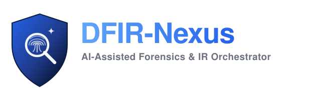
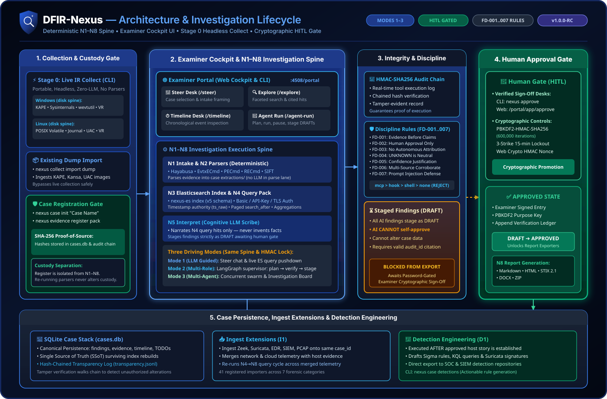

# DFIR-Nexus

<p align="center">
  
</p>

<p align="center">
  <strong>One audit chain. One unified process. AI-assisted. Examiner-approved.</strong>
</p>

<p align="center">
  <a href="LICENSE"></a>
  
  
  
  
  
</p>

---

## Executive Overview

**DFIR-Nexus** is an enterprise-grade digital forensics and incident response (DFIR) integration layer and investigation cockpit. Developed as part of the [CADRE](https://github.com/Ganron007/CADRE) platform programme, DFIR-Nexus consolidates disparate forensic tools—including Eric Zimmerman's tools, SIFT, Volatility 3, Hayabusa, KAPE, and Velociraptor—into a single, cryptographically verifiable investigation lifecycle.

By unifying evidence acquisition, deterministic parsing, high-throughput search, and AI-assisted hypothesis generation, DFIR-Nexus eliminates manual correlation bottlenecks while enforcing an unbreakable **human-in-the-loop (HITL) chain of custody**.

> [!IMPORTANT]
> **Forensic Integrity & Audit Guarantee**
> - **Tamper-Evident Ledger:** Every tool execution, query, and finding is appended to an immutable **HMAC-SHA256 audit chain**.
> - **Cryptographic Approval:** Findings remain **DRAFT** until signed by an examiner using **PBKDF2-HMAC (600,000 iterations)**.
> - **Hardened AI Boundary:** AI models and automated agents can query, cite, and draft; they **cannot** approve, alter, or delete findings.
> - **Air-Gapped & Offline-First:** Zero external telemetry. All forensic state, indices, and models operate within your local perimeter.

---

## Why DFIR-Nexus?

Modern forensic investigations suffer from extreme tooling fragmentation:
- Analysts juggle dozens of CLI utilities (MFTECmd, Hayabusa, Chainsaw, Volatility, PECmd, Plaso), producing disjointed CSVs and logs.
- Correlating millions of events under incident response pressure leads to cognitive fatigue, missed leads, and audit vulnerabilities.
- Traditional "AI for DFIR" solutions attempt to replace core parsers with hallucinations or bypass chain-of-custody requirements.

**DFIR-Nexus solves this through structured orchestration:**

```text
 ┌─────────────────┐     ┌──────────────────┐     ┌────────────────────────┐     ┌──────────────────┐
 │  Stage 0 Collect│ ──▶ │ Custody Register │ ──▶ │  N1–N8 Unified Spine   │ ──▶ │ Cryptographic    │
 │  (Host-native)  │     │ (SHA-256 Hashed) │     │ (Parse, Index, Invest) │     │ Sign-off & Report│
 └─────────────────┘     └──────────────────┘     └────────────────────────┘     └──────────────────┘
```

1. **Host-Native IR Collection (CLI):** Lightweight, zero-model collection across current Windows and modern Linux targets.
2. **Cryptographic Registration:** Pre-analysis SHA-256 hashing locks evidence immutability.
3. **Deterministic Tool Lane:** Proven forensic binaries parse raw evidence into structured schemas before any AI touches it.
4. **Examiner Cockpit & Dual Storage:** A high-speed React workspace backed by SQLite (single source of truth) and Elasticsearch (log search acceleration).
5. **Flexible Investigation Depths:** Three purpose-built modes tailored to operator preference, from interactive steer chat to autonomous multi-agent teams.

---

## Architecture & Investigation Lifecycle

DFIR-Nexus organizes the entire investigative lifecycle into the deterministic **N1–N8 Investigation Spine**:

<p align="center">
  <a href="assets/dfir-nexus-architecture.svg">
    
  </a>
</p>

### The N1–N8 Investigation Spine

| Phase | Stage | Description | Technology |
| :---: | :--- | :--- | :--- |
| **N1** | **Intake & Scope** | Ingest investigation scope, incident time windows, key entities, and hypotheses. | SQLite / `CASE.yaml` |
| **N2** | **Deterministic Parse** | Execute mandatory parser lane against all registered host artifacts (EVTX, Prefetch, MFT, SRUM, Registry, Memory). | Zimmerman, Hayabusa, Volatility 3 |
| **N3** | **Index & Map** | Bulk-index normalized records into per-case schemas with timestamp authority (`ts_raw`, `ts_precision`). | Elasticsearch (`nexus-es`) / SQLite |
| **N4** | **Attack Needle Query** | Scan for MITRE ATT&CK techniques, LOLBAS patterns, and keyword pivots. | DSL Query Pushdown / Aggregations |
| **N5** | **AI Interpretation** | Analyze retrieved hits, correlate cross-artifact signals, and synthesize DRAFT findings with row citations. | Mode 1 (LLM) / Mode 2 / Mode 3 |
| **N6** | **Examiner Sign-Off** | Cryptographic review and HMAC password sign-off (DRAFT → APPROVED). | PBKDF2-HMAC (3-strike lockout) |
| **N7** | **Timeline Synthesis** | Construct unified per-family multi-lane timelines with brush-zoom filtering. | Elastic / Canvas Timeline |
| **N8** | **Forensic Export** | Compile court-ready reports and structured bundles strictly from APPROVED findings. | Markdown, HTML, DOCX, STIX 2.1, ZIP |

---

## The Three Investigation Modes

DFIR-Nexus supports three distinct analytical control depths over the same N1–N8 spine. The mode is selected at case creation to ensure strict audit isolation:

| Capability | Mode 1: LLM Guided Desk | Mode 2: Multi-Role Supervisor | Mode 3: Multi-Agent Swarm |
| :--- | :--- | :--- | :--- |
| **Operator Model** | **Interactive Steering** | **Supervised Work Orders** | **Autonomous Collaboration** |
| **Runtime Architecture** | Examiner + LLM Scribe | LangGraph Supervisor | Concurrent Multi-Seat Swarm |
| **Execution Flow** | Conversational chat with live ES queries | Sequential roles: Director → Workers → Verifier | Parallel seats: Evidence, Correlation, Pattern |
| **Dispute Resolution** | Handled directly in examiner chat | Verifier confirms, infers, or refutes candidates | Shared Investigation Board opens & settles disputes |
| **Candidate Staging** | Examiner bookmarks or clicks propose | Examiner stages verified candidate work orders | Examiner stages settled board claims |
| **Primary UI Surface** | **Steer Chat** (`/portal/app/steer`) | **Agent Run — Lanes** (`/portal/app/agent-run`) | **Investigation Board** (`/portal/app/agent-run`) |

### Mode 1 — LLM Guided Analysis
The examiner leads the investigation in natural language. The LLM translates questions into typed queries against Elasticsearch, retrieves exact hits, and provides cited answers with millisecond execution. The examiner bookmarks hits and stages DRAFT findings with one click.

### Mode 2 — Multi-Role Supervisor
A LangGraph supervisor plans sequential work orders mapped to knowledge base skills. Specialized read-only agent roles (Evidence Worker, Correlation Worker, Verifier, Synthesis) execute bounded analysis cycles, verify claims against raw rows, and present structured candidates for examiner staging.

### Mode 3 — Concurrent Multi-Agent Swarm
A concurrent agent team fans out across evidence families in synchronized supersteps. Each seat publishes audit-backed claims onto a shared Investigation Board. Conflicting hypotheses trigger formal disputes and bounded re-dispatch passes; unresolved items are preserved honestly as gaps.

---

## Storage & Search Architecture

DFIR-Nexus implements a dual-layer storage model separating forensic provenance from high-throughput query acceleration:

```
┌────────────────────────────────────────┐     ┌────────────────────────────────────────┐
│     SQLite Case Ledger (SSoT)          │     │    Elasticsearch Cluster (N3 Engine)   │
├────────────────────────────────────────┤     ├────────────────────────────────────────┤
│ • Case Metadata & Scope                │     │ • Normalized Event Indexing (N3)       │
│ • Registered Evidence SHA-256 Hashes   │     │ • DSL & Field Filter Query Pushdown    │
│ • DRAFT & APPROVED Finding States      │     │ • Native Aggregations & Histogram Paging│
│ • HMAC-SHA256 Verification Audit Chain │     │ • Authenticated (Basic / API Key / TLS)│
│ • Timeline Events & Investigator TODOs │     │ • Paged search_after (Zero Record Caps)│
└────────────────────────────────────────┘     └────────────────────────────────────────┘
```

- **Forensic State & Ledger (SQLite):** Permanent single source of truth. Offline-first, zero external dependencies. Survives index rebuilds.
- **Search Backend (Elasticsearch):** High-scale query acceleration. Indexes millions of rows without row caps or truncation. If Elasticsearch is offline, Mode 1 falls back to deterministic CSV processing; agentic modes cleanly enforce availability.

---

## Examiner Cockpit (Web UI)

DFIR-Nexus features a modern, responsive **Examiner Cockpit** built with React, Vite, and Tailwind CSS, served locally via `nexus serve --http` at `http://127.0.0.1:4508`:

| Workspace Desk | Role & Capabilities |
| :--- | :--- |
| **Case Setup** | Case creation, scope definition, and investigation mode binding (Mode 1, 2, or 3). |
| **Steer Chat** | Real-time SSE streaming chat with live evidence query pushdown and one-click DRAFT proposal. |
| **Explore** | High-performance faceted DSL search, type-aware columns, histograms, and bookmarking. |
| **Timeline** | Per-family multi-lane event visualization with brush-zoom temporal filtering. |
| **Agent Run** | Real-time streaming visualization for Mode 2 work orders and Mode 3 Investigation Board claims. |
| **Workbench** | Examiner promotion desk converting bookmarked evidence hits into structured DRAFT findings. |
| **Approval Desk**| Cryptographic PBKDF2-HMAC sign-off desk with brute-force lockout protection. |
| **Report Desk** | Automated export generator compiling official forensic reports strictly from APPROVED findings. |
| **Transparency** | Audit verification desk verifying SHA-256 hashes and HMAC ledger integrity in real time. |

---

## Quickstart

### 1. Installation

Install native prerequisites and the Python package:

```powershell
# Windows (PowerShell 7+)
.\setup-windows.ps1

# Linux / macOS (Bash)
./setup-linux.sh

# Or direct pip installation:
pip install -e .[all]
```

### 2. Configuration & Preflight

Initialize your examiner identity and approval password:

```bash
nexus config --examiner "Jane Doe"
nexus config --setup-password
nexus doctor                          # Verify tools, binaries, and environment
```

### 3. Investigation Walkthrough

```bash
# Step 1: Collect live forensic pack (CLI, freeze first)
nexus collect run --os windows --host 192.168.1.50 --user analyst --identity ~/.ssh/id_rsa

# Step 2: Initialize Case and Register Evidence (Custody Gate)
nexus case init "Incident-2026-Alpha"
nexus evidence register /path/to/evidence.raw -d "Target Host Disk"

# Step 3: Run Deterministic Parsers (N2)
nexus pipeline --mode tools --from-case CASE-XXXXXXXX --case /path/to/evidence.raw

# Step 4: Launch Web Cockpit or CLI Investigation
nexus serve --http                    # Starts Cockpit & MCP server on port 4508
nexus portal                          # Opens browser to http://127.0.0.1:4508

# Or investigate directly via CLI:
nexus case ask --question "Did PowerShell execute encoded commands?"
nexus approve --examiner "Jane Doe" F-001    # Cryptographic sign-off
nexus report generate -s report.md           # Court-ready report from APPROVED findings
```

---

## Forensic Tools & Integrations

DFIR-Nexus bundles and orchestrates **128 Windows and 125 Linux MCP tools**:

- **Windows Forensic Spine:** MFTECmd, EvtxECmd, PECmd, LECmd, JLECmd, SBECmd, RBCmd, SrumECmd, RECmd, AmcacheParser, AppCompatCacheParser, WxTCmd, SQLECmd.
- **Triage & Detection:** Hayabusa, Chainsaw, Suzaku, Zircolite, DeepBlueCLI, PersistenceSniper, Sysinternals (`autorunsc`, `sigcheck`).
- **Memory Analysis:** Volatility 3, MemProcFS integration.
- **Network Analysis:** `tshark` PCAP session extraction, Zeek logs, Suricata EVE alerts, `nfdump` NetFlow.
- **Live Host Collection (Stage 0):** KAPE, Velociraptor (`CADRE.Hunts.IRTriage`), UAC, POSIX volatile, DFIR-ORC, Kansa.
- **Threat Intelligence:** Direct integrations with 10 TI providers (ThreatFox, MalwareBazaar, URLhaus, Yaraify, MISP, OTX, Shodan, VirusTotal, AbuseIPDB, CrowdStrike).
- **Forensic RAG:** Built-in ChromaDB repository holding 22,000+ DFIR methodology records, Sigma rules, SANS posters, and LOLBAS/GTFOBins guides.

---

## Engineering Rigor & Verification

The DFIR-Nexus platform adheres to strict software and forensic engineering disciplines:

```
[✓] Hermetic Test Suite:    2,359 Python tests passed (0 failed, 8 skipped)
[✓] Frontend Test Suite:    222 Vitest unit & journey tests passed (38 files)
[✓] E2E Journeys:           7/7 full-cycle integration steps verified
[✓] Accessibility:          11/11 WCAG 2.1 AA a11y & visual tests verified
[✓] Style Budget:           Zero CSS token leaks or raw color violations
[✓] Static Analysis:        Ruff clean, TypeScript clean, zero uncommitted diffs
```

Run tests locally:
```bash
# Run backend pytest suite
pytest

# Run frontend Vitest suite
cd frontend && npm run test:unit

# Run full functional audit
python tests/functional_audit.py
```

---

## Documentation Map

Detailed operational guides and architectural specifications are located in [`Docs/`](Docs/):

* 🧭 **[Docs/NEXUS-MODE.md](Docs/NEXUS-MODE.md):** Complete operator loop, mental model, and investigation modes.
* 📚 **[Docs/guide.md](Docs/guide.md):** Step-by-step forensic investigation manual.
* ⚙️ **[Docs/SETUP.md](Docs/SETUP.md):** Environment variables, Elasticsearch authentication, and VM topology.
* 🔬 **[Docs/ARCHITECTURE.md](Docs/ARCHITECTURE.md):** Deep architectural blueprints, trust boundaries, and tool index.
* 💻 **[Docs/CLI.md](Docs/CLI.md):** Exhaustive command-line interface reference.
* ⚖️ **[FORENSIC-DISCIPLINE.md](FORENSIC-DISCIPLINE.md):** Forensic discipline rules (FD-001 to FD-007).
* ❔ **[Docs/FAQ.md](Docs/FAQ.md):** Frequently asked questions and troubleshooting.

---

## License & Attribution

Distributed under the **MIT License**. See [LICENSE](LICENSE) for full terms.

* The prebuilt **RAG index** (~22,000 IR records) and Windows triage baselines are developed by [Applied Incident Response](https://github.com/AppliedIR/sift-mcp) under the MIT License.
* Core forensic utilities (Zimmerman tools, Hayabusa, Volatility, Velociraptor) remain the intellectual property of their respective authors.

> Copyright (c) 2026 DFIR-Nexus contributors.
